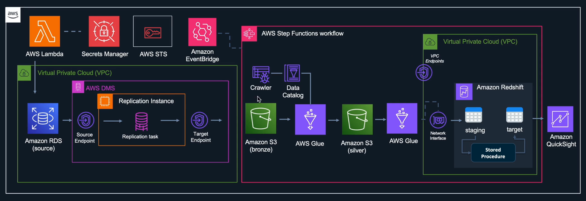
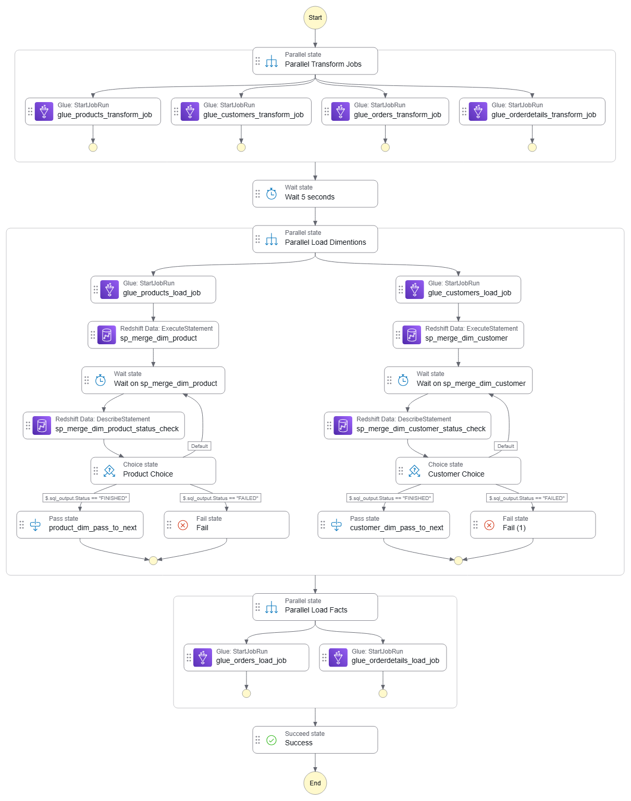
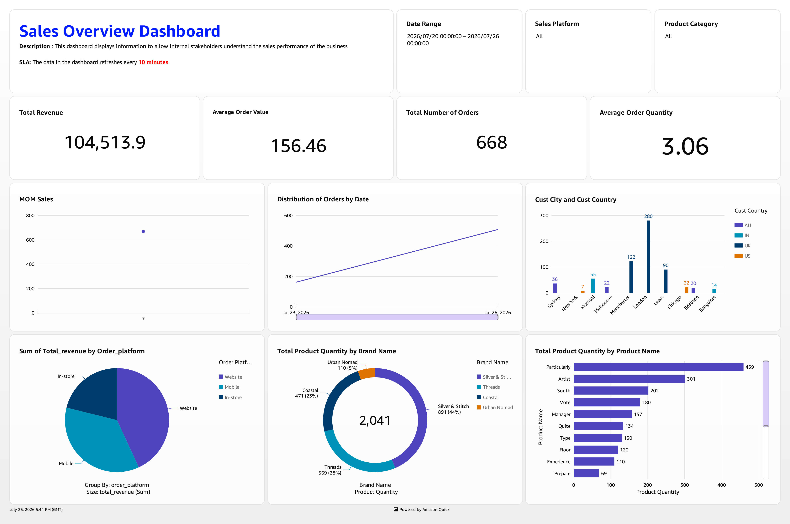

# Retail Data Pipeline: End-to-End Change Data Capture (CDC) & SCD Type 2 ETL

An enterprise-grade, cloud-native data engineering pipeline designed to ingest, transform, and analyze transactional retail data in near real-time. This project implements **Change Data Capture (CDC)** to stream updates from an operational database into an analytical data warehouse, applying **Slowly Changing Dimensions (SCD Type 2)** logic for historical tracking.



---

## 🛠️ Tech Stack & AWS Services

- **Data Simulation:** [AWS Lambda](https://aws.amazon.com/lambda/) (Python & Faker) simulated operational CRUD transactions.
- **Secrets Management:** [AWS Secrets Manager](https://aws.amazon.com/secrets-manager/) stored RDS and Redshift database credentials securely.
- **Operational Database (OLTP Source):** [Amazon RDS for MySQL](https://aws.amazon.com/rds/mysql/) hosted transactional tables.
- **Change Data Capture (CDC):** [AWS Database Migration Service (DMS)](https://aws.amazon.com/dms/) captured database updates and replicated them to Amazon S3.
- **Data Lake Storage:** [Amazon S3](https://aws.amazon.com/s3/) organized data into structured zones:
  - **Bronze Zone:** Raw CDC outputs in CSV format.
  - **Silver Zone:** Cleaned, snake_case formatted, and partitioned Parquet files.
- **Data Cataloging:** [AWS Glue Crawler](https://aws.amazon.com/glue/) & [AWS Glue Data Catalog](https://aws.amazon.com/glue/) managed raw schemas dynamically.
- **Distributed Computing (ETL):** [AWS Glue Spark Jobs](https://aws.amazon.com/glue/) executed PySpark scripts for massive parallel data transformations.
- **Workflow Orchestration:** [AWS Step Functions](https://aws.amazon.com/step-functions/) coordinated the Glue Spark jobs, timers, and warehouse stored procedures.
- **Data Warehouse (OLAP Target):** [Amazon Redshift Serverless](https://aws.amazon.com/redshift/) stored staging and production data.
- **Analytical Stored Procedures:** PL/pgSQL routines performed idempotent upsert/merge logic for SCD Type 2 tracking.
- **Business Intelligence (BI):** [Amazon QuickSight](https://aws.amazon.com/quicksight/) visualized sales KPIs, platform breakdowns, and regional performance.

---

## 🔄 Data Flow & Pipeline Stages

### 1. Transaction Generation & Source Storage
- An [AWS Lambda function](Resources/lambda/lambda_function/lambda_function.py) runs on a schedule (triggered via Amazon EventBridge every 2 minutes) to simulate retail transactions (Inserts, Updates, Deletes) using the Python `Faker` library.
- Transaction data is persisted across five tables in [Amazon RDS MySQL](Resources/SQL/DDL/mysql_source_ddl.sql): `Product`, `Customer`, `Orders`, and `orderDetails`.

### 2. Real-Time Ingestion (CDC)
- AWS DMS captures source changes from MySQL binary logs.
- The updates are continuously streamed to an S3 **Bronze Bucket** as raw datasets, maintaining CDC metadata (`op` flag: `I` for Insert, `U` for Update, `D` for Delete).

### 3. PySpark ETL Transformation
- Triggered by [EventBridge](Resources/eventbridge/) and orchestrated by [Step Functions](Resources/stepfunctions/), PySpark Glue jobs perform schema transformations:
  - Renaming fields to standard database `snake_case`.
  - Dynamically casting data types (timestamps, decimals).
  - Adding metadata fields (e.g. `hash_value` via SHA-256 to track row changes, `ingestion_date`).
- Cleaned datasets are saved in the S3 **Silver Bucket** as partitioned Parquet files (`partitionKeys=["ingestion_date"]`).

### 4. Data Warehouse Loading & Merge (SCD Type 2)
- Step Functions trigger load jobs that pull Parquet files from S3 Silver and copy them into Redshift staging tables (`sales.stage_dim_customer`, etc.).
- Stored procedures are called in Redshift to execute target-table merges:
  - **SCD Type 2 (Dimensions):** For any modified or deleted record, the existing row's `active_flag` is set to `0` and its `record_end_ts` is updated. A new record is inserted with `active_flag = 1` and `record_start_ts = current_timestamp`.
  - **Facts:** Inserts are appended directly to fact tables.
- Staging tables are truncated post-merge to maintain idempotency.

---

## 🔀 Step Functions Orchestration

The pipeline execution is orchestrated by a state machine that handles parallel workflows, ensures dependency resolution, and handles failures.



1. **Parallel Transform Jobs:** Runs Glue ETL jobs for `product`, `customer`, `orders`, and `order-details` transformations simultaneously.
2. **Wait State:** Delays execution by 5 seconds to ensure S3 writer threads finish committing Parquet data.
3. **Parallel Load Dimensions & Merge:** 
   - Loads dimension datasets (Product, Customer) into Redshift staging tables.
   - Executes Redshift stored procedures `sp_merge_dim_product()` and `sp_merge_dim_customer()` to merge dimensions.
   - Polls the statement execution status until it transitions to `FINISHED`.
4. **Parallel Load Facts:** Loads fact datasets (Orders, Order Details) into Redshift fact tables after dimensions are updated.

---

## 📂 Folder Structure

```directory
retail-data-pipeline/
├── .env.template            # Template for local environment variables
├── .gitignore               # Excludes sensitive files, cache, and zip archives
├── pyproject.toml           # Project dependencies and packaging settings
├── docs/                    # Architecture diagrams and design documents
│   ├── AWS_Quicksight_dashboard.pdf
│   └── images/
│       ├── architecture-diagram.png
│       ├── AWS_Quicksight_dashboard.png
│       └── stepfunctions_graph.png
└── Resources/               # Core pipeline infrastructure code
    ├── SQL/                 # Database schema migrations and stored procedures
    │   ├── DDL/             # Redshift and MySQL table creation scripts
    │   ├── SP/              # Redshift SCD Type 2 stored procedures
    │   └── VALIDATION/      # Quality control & validation queries
    ├── eventbridge/         # EventBridge CloudFormation trigger templates
    ├── glue/                # PySpark ETL scripts
    │   └── etl_jobs/
    │       ├── transformations/ # S3 Bronze -> S3 Silver Spark jobs
    │       ├── dimensions/     # Silver -> Redshift Dimension load jobs
    │       └── facts/          # Silver -> Redshift Fact load jobs
    ├── lambda/              # Data generation simulator
    │   ├── lambda_function/ # Lambda source code
    │   │   └── lambda_function.py
    │   └── requirements.txt # Python dependencies for local packaging
    └── stepfunctions/       # Step Functions workflow definitions
        └── stepfunctions_code.json
```

---

## 🚀 Setup & Deployment Instructions

### 1. Database Setup
- Deploy an Amazon RDS MySQL instance. Run the [source DDL script](Resources/SQL/DDL/mysql_source_ddl.sql) to create operational tables.
- Spin up an Amazon Redshift Serverless workgroup and database. Run [DDL scripts](Resources/SQL/DDL/) to create staging and target production tables, and register the [stored procedures](Resources/SQL/SP/).

### 2. Lambda Simulator Deployment
- Navigate to the [lambda directory](Resources/lambda/).
- Install dependencies locally and bundle them for deployment:
  ```bash
  cd Resources/lambda
  pip install -r requirements.txt -t lambda_function/
  cd lambda_function
  zip -r ../lambda_function.zip .
  ```
- Upload `lambda_function.zip` to AWS Lambda. Attach an IAM role with access to RDS and AWS Secrets Manager. Set `SECRET_NAME` and `REGION_NAME` in Lambda's environment variables.

### 3. Change Data Capture (AWS DMS)
- Setup an AWS DMS replication instance.
- Define a Source Endpoint connecting to RDS MySQL and a Target Endpoint connecting to the S3 Bronze bucket.
- Create a Database Migration Task selecting replication type **Ongoing replication (CDC)**.

### 4. Glue Crawlers & ETL Jobs
- Create an AWS Glue Database named `retail-data-pipeline-glue-db`.
- Setup a Glue Crawler targeting the S3 Bronze bucket to infer raw schemas.
- Deploy the PySpark scripts located in [Resources/glue/etl_jobs/](Resources/glue/etl_jobs/) to AWS Glue Spark environments.

### 5. Orchestration (AWS Step Functions)
- Create a state machine in AWS Step Functions using the JSON definition from [stepfunctions_code.json](Resources/stepfunctions/stepfunctions_code.json).
- Provide the Step Functions service role with permissions to run Glue Jobs and call Redshift Data API statements.

---

## 📈 Analytics & Reporting
The pipeline enables comprehensive retail intelligence. Downstream stakeholders interact with the [QuickSight Dashboard](docs/AWS_Quicksight_dashboard.pdf) to gain real-time insight into operations.



The dashboard displays:
- **Financial KPIs:** Total Revenue, Average Order Value (AOV), and Total Orders.
- **Sales Channels:** Percentage breakdown across Web, Mobile, and In-Store.
- **Product Analysis:** Popular brands (e.g. Silver & Stitch, Threads) and individual product quantities.
- **Regional Segments:** Sales performance broken down by customer country (UK, US, IN, AU).
